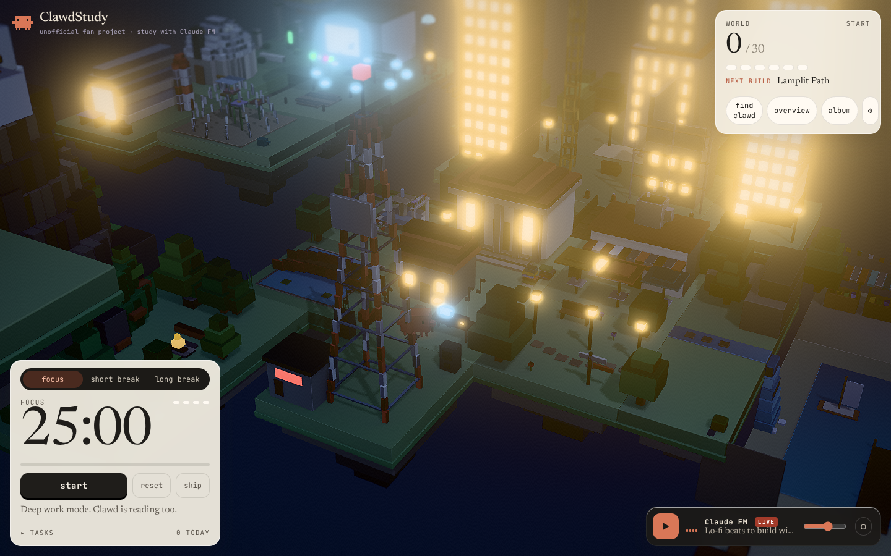
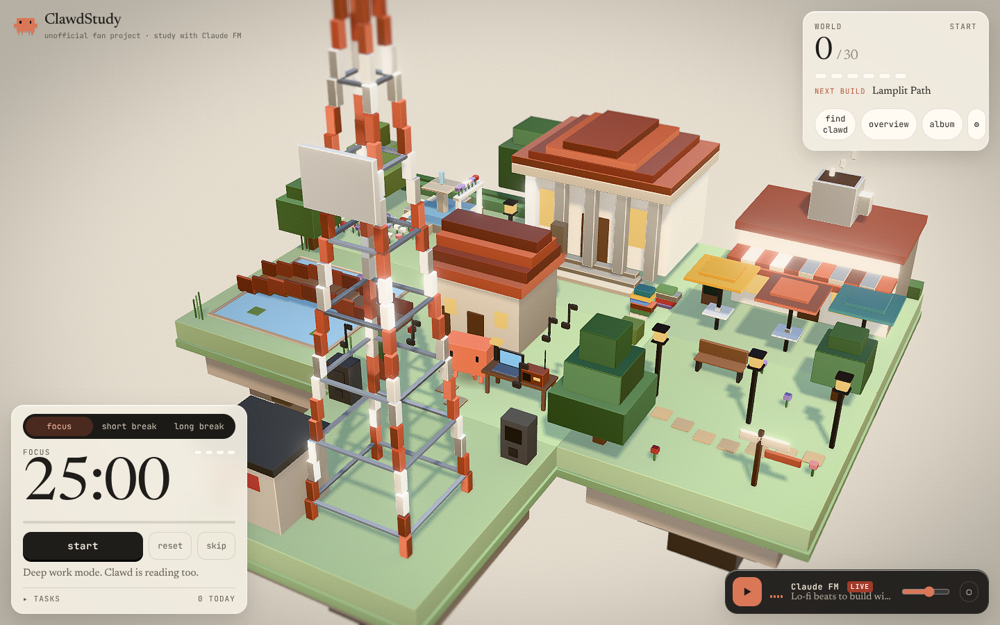
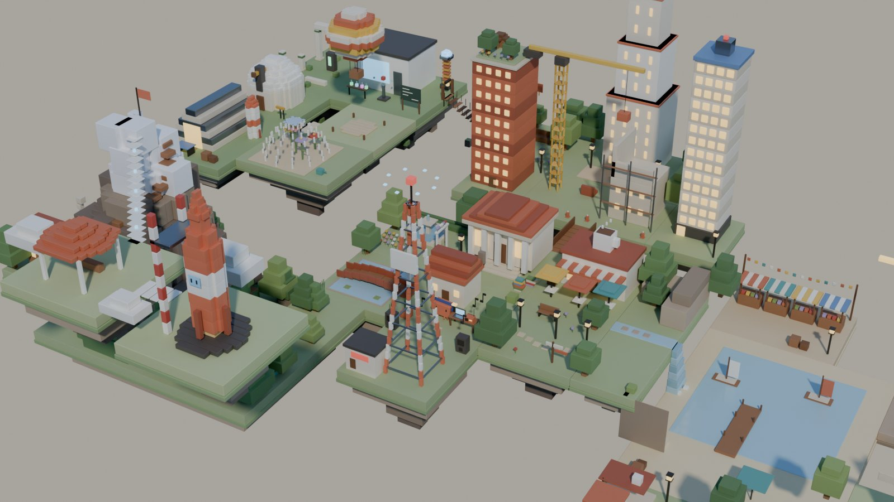

# ClawdStudy

A study site where **every pomodoro you finish builds a new piece of Clawd's world**.
Put on [Claude FM](https://www.youtube.com/watch?v=tRsQsTMvPNg), start the timer, and
watch Clawd's Archipelago grow from a single hut into 30 places: a café, a library, a harbour, a lighthouse,
a city skyline, a science isle, a mountain, and finally a rocket to the moon.



> Unofficial fan project. Not affiliated with Anthropic. Claude FM streams from YouTube.

## How it works

- **Pomodoro timer** (Pomofocus-style): focus / short break / long break, a long break every N blocks,
  auto-start options, a task list with estimates, chimes and optional desktop notifications.
- **1 finished focus block = 1 new region.** The new region's blocks drop into place, then Clawd walks over
  and uses it (reads at the library, sips at the café, puts on a hard hat at the construction site).
  If you reset or skip a focus block, nothing gets built.
- **Claude FM** plays through the YouTube IFrame API. It's only loaded when you press play (or start
  a focus block, if you turn that on), so it never slows down the first load.
- **Day and night** follow your local clock. Windows, lamps and the lighthouse light up, and the aurora and
  stars come out once you've unlocked them.
- **Local-first.** Progress, tasks and settings are kept in `localStorage`. Settings has export and import.

Keys: `Space` start/pause · `C` find Clawd · `O` overview · `M` play/pause music.

| Village, live in the browser | Everything, path-traced in Cycles |
|---|---|
|  |  |

## Run it

```bash
npm install
npm run dev
```

URL flags for demos and testing:

| Flag | Effect |
|---|---|
| `?fast=5` | every block lasts 5 seconds |
| `?debug` | slider to scrub through unlocks, a "complete focus" button and live renderer stats |
| `?time=22` | force the hour (try 19 for dusk, 23 for night) |

## The look: a photographed miniature

- **Cycles-baked light.** Blender path-traces sky light, bounce light and contact occlusion into a lightmap
  for every region (`world/lm/*.webp`, 700 KB total). The browser adds only the direct sun, so it gets
  path-traced lighting for the cost of one texture read.
- **Defined edges.** Every block is bevelled with hardened normals, so edges catch highlights. Each corner
  carries its own roughness and metalness, so water and glass shine, steel is metallic and grass stays matte.
  The palette is converted from sRGB to linear properly.
- **Lens and finish:** neutral tone mapping, a procedural sky environment for reflections, soft 4K shadows,
  a tilt-shift depth of field, bloom on lamps and windows at night, light sharpening, vignette and grain.
  Quality drops step by step if frames run slow.
- **Postcards.** Every place you unlock comes with a real Cycles render of it (`blender/postcards.py`),
  shown on unlock and collected in the album (`P`).

## The world is generated by Blender

Everything 3D (the 31 regions, Clawd's mesh and rig, and 10 animation clips) comes from Python
scripts run against **Blender 5 as a Python module** (`bpy`). Nothing in it is hand-modelled.

```
blender/
  lib/voxel.py     box/voxel builder: merges boxes into a few meshes per region, with vertex colours,
                   cheap contact shading and a per-box `_drop` attribute that drives the reveal animation
  clawd.py         Clawd mesh + armature + actions (idle, walk, dance, read, sip, hammer, wave, sleep,
                   celebrate, look) + accessories (headphones, hard hat, goggles, mug, book, party hat...)
  regions.py       the 31 regions, plus Clawd's walking routes and actions for each one
  build_all.py     exports region_XX.glb + world.json
scripts/build-world.sh   runs it all and compresses with gltf-transform (meshopt)
```

To rebuild after editing a region:

```bash
uv venv -p 3.11 .bpy && uv pip install -p .bpy bpy   # one-time
npm run world        # geometry + Cycles lightmaps (~10 min on CPU)
npm run postcards    # 31 path-traced postcards + hero shot (~40 min on CPU)
```

## Performance

Smoothness was the main requirement:

- The first load is the UI only (about 9 KB gzipped of JS), so the timer works before any 3D loads.
  three.js and the world load as a separate chunk.
- Each region is merged into 2–5 meshes with one shared material and one lightmap. The full 30-region world
  is about 3.5 MB of compressed geometry and lightmaps, loaded per region as you unlock it. A frame takes
  about 1.2 ms of CPU.
- The shadow map only re-renders when something changes (a reveal or a time-of-day step). Clawd uses
  a blob shadow.
- The next region is downloaded while you focus, so its reveal starts instantly.
- Resolution adapts to frame time, rendering stops when the tab is hidden, and there's a low-power mode
  (30 fps, no shadows).
- The timer counts down to a stored end timestamp and ticks from a Web Worker, so it doesn't drift
  in background tabs and it survives reloads.
